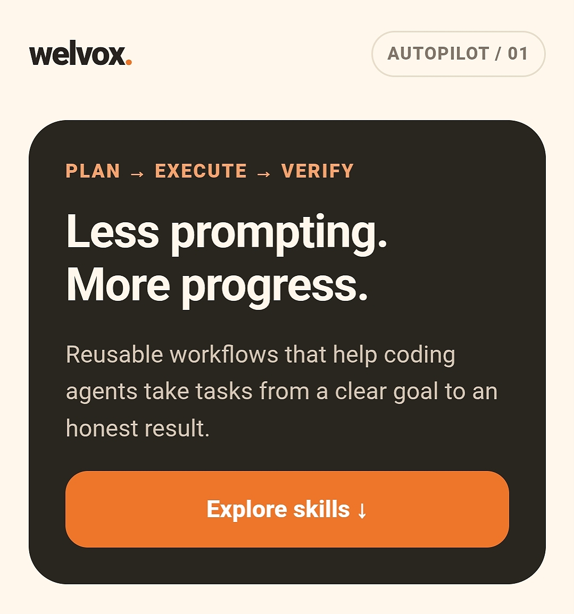

Welvox AUTOPILOT

Less prompting. More progress.

Welvox AUTOPILOT is an open-source collection of reusable workflow instructions designed to help AI coding agents carry software tasks from a clear goal through planning, implementation, verification, and final reporting.

The project includes individual "SKILL.md" files for different software engineering tasks and a lightweight website for discovering and reading those skills.

  

**🌐 Live Demo:** [Explore Welvox AUTOPILOT](https://piyush2707.github.io/Welvox-autopilot/)

[🚀 View Welvox AUTOPILOT Releases](https://github.com/Welvox-In/welvox-autopilot/releases)

The goal is simple: make AI-assisted development more structured, useful, transparent, and reliable.

---

Table of Contents

- "About the Project" (#about-the-project)
- "Why Welvox AUTOPILOT?" (#why-welvox-autopilot)
- "Features" (#features)
- "Skill Library" (#skill-library)
- "How It Works" (#how-it-works)
- "Website" (#website)
- "Installation" (#installation)
- "How to Use a Skill" (#how-to-use-a-skill)
- "Example Tasks" (#example-tasks)
- "Repository Structure" (#repository-structure)
- "Compatibility" (#compatibility)
- "Safety and Limitations" (#safety-and-limitations)
- "Roadmap" (#roadmap)
- "Contributing" (#contributing)
- "License" (#license)
- "Acknowledgments" (#acknowledgments)

---

About the Project

AI coding agents can help write code, debug errors, review changes, and plan new applications. However, complex tasks benefit from a consistent workflow rather than a collection of disconnected instructions.

Welvox AUTOPILOT provides reusable instructions that help an agent approach a task systematically:

1. Understand the user's goal.
2. Inspect the relevant project and available tools.
3. Break the work into manageable steps.
4. Implement the appropriate changes.
5. Verify the results using available checks.
6. Report completed work, limitations, and unresolved issues.

The project is designed to be lightweight and easy to explore. Its skills are stored as Markdown files, and its website is built as a standalone HTML page.

Important: Welvox AUTOPILOT is an instruction toolkit, not an autonomous AI model. The AI agent and its environment determine which tools, permissions, and capabilities are available.

Why Welvox AUTOPILOT?

Without a structured workflow, an AI coding agent may stop after providing a plan, overlook verification, or fail to communicate what remains unfinished.

Welvox AUTOPILOT encourages a more complete process.

The project focuses on five principles:

- Execution: Move from a defined goal toward a completed task.
- Structure: Break complicated work into clear, manageable steps.
- Verification: Check changes instead of assuming they work.
- Transparency: Report what was actually done and tested.
- Responsible autonomy: Work independently within granted permissions and request approval when necessary.

The intention is not to eliminate human judgment. It is to help people and AI agents collaborate more effectively.

Features

- Reusable, task-specific AI agent skills.
- A lightweight website for exploring available skills.
- Searchable skill library, when supported by the deployed website.
- Individual Markdown instruction files that can be inspected and copied.
- Workflows for implementation, debugging, code review, and project planning.
- No dedicated backend or database required for the basic website.
- A repository structure that supports adding more skills over time.

The website uses the repository's published files to display the available skills. Its actual behavior depends on the current implementation and successful access to those files.

---

Skill Library

The repository currently contains four core skills.

1. Autopilot

Location: "skills/autopilot/SKILL.md"

Purpose: Guide an AI coding agent through a multi-step software engineering task from initial understanding to final reporting.

The workflow encourages the agent to:

- Understand the requested outcome and constraints.
- Inspect relevant project files.
- Develop an actionable plan.
- Implement the necessary changes.
- Handle recoverable errors.
- Run appropriate verification checks.
- Summarize the result honestly.

Use it for: Implementing features, modifying an existing application, refactoring code, or completing a defined repository task.

2. Bug Fixer

Location: "skills/bug-fixer/SKILL.md"

Purpose: Help identify and resolve software defects systematically.

The workflow encourages the agent to:

- Understand expected versus actual behavior.
- Inspect errors, relevant code, and tests.
- Reproduce the issue when possible.
- Investigate the root cause.
- Make a focused fix.
- Run relevant tests or checks.
- Identify remaining risks.

Use it for: Runtime errors, broken features, failing tests, unexpected behavior, and reproducible defects.

3. Code Reviewer

Location: "skills/code-review/SKILL.md"

Purpose: Evaluate code for meaningful defects and engineering risks.

The workflow focuses on:

- Correctness and edge cases.
- Potential security vulnerabilities.
- Reliability and error handling.
- Maintainability.
- Missing or inadequate test coverage.
- Clear, prioritized, actionable findings.

Use it for: Reviewing code changes, pull requests, existing implementations, and proposed fixes.

A review should distinguish confirmed problems from speculation and should not modify code unless the user requests changes.

4. Project Planner

Location: "skills/project-planner/SKILL.md"

Purpose: Convert a software idea into a practical implementation plan.

The workflow covers:

- Defining goals and success criteria.
- Understanding the existing project.
- Separating essential requirements from optional features.
- Organizing work into milestones.
- Identifying dependencies, risks, and blockers.
- Defining verification criteria.

Use it for: Starting a new application, planning a major feature, organizing a refactor, or deciding how to approach a technical project.

Adding more skills

The library can grow with additional focused workflows, such as test writing, documentation generation, performance analysis, accessibility review, or release preparation.

A new skill should have its own directory and a "SKILL.md" file containing the required metadata and clear, actionable instructions.

For example:

skills/
├── autopilot/
│   └── SKILL.md
├── bug-fixer/
│   └── SKILL.md
├── code-review/
│   └── SKILL.md
└── project-planner/
    └── SKILL.md

---

How It Works

Welvox AUTOPILOT has two main parts.

1. The skill files

Each skill is a Markdown document containing instructions for an AI coding agent. A skill defines when it should be used, the workflow to follow, important constraints, and how to report the outcome.

The files are plain text, so they can be inspected, copied, version-controlled, and adapted.

2. The website

The website provides a convenient interface for browsing the skill library.

Depending on the deployed implementation, visitors can explore available skills, search the library, preview instructions, and copy content for use in their own environment.

The basic site is designed to run without a dedicated application server, database, or API key.

The website does not itself execute AI coding tasks. Execution happens in a compatible AI agent or coding environment after the relevant instructions are supplied.

-----

Installation

Skills are Markdown instructions. The installation method depends on the AI agent or development environment being used.

The paths below are common project-level locations for compatible tools. Check the documentation for your particular agent before relying on a path or assuming a skill will be discovered automatically.

Claude Code

For an environment that supports Claude Code project skills, copy the desired skill into a corresponding directory.

Example for Autopilot:

.claude/
└── skills/
    └── autopilot/
        └── SKILL.md

OpenAI Codex

For an environment that supports Codex project skills, a common project-level location is:

.agents/
└── skills/
    └── autopilot/
        └── SKILL.md

Other AI coding agents

For other agents, consult their documentation to determine whether they support reusable skills, Markdown instruction files, repository guidance files, or custom workflows.

If a tool does not support skill discovery, you may still be able to provide the instructions directly in its conversation or task prompt.

Compatibility is not automatic: a Markdown skill can be portable as text without every agent supporting the same installation format or executing the workflow in the same way.

---

How to Use a Skill

A typical workflow looks like this:

1. Choose the skill that matches your task.
2. Read its instructions.
3. Install it in a supported location or supply the instructions directly to your agent.
4. Describe the task, expected result, and relevant constraints.
5. Allow the agent to inspect the project and follow the workflow.
6. Review the changes and verification results.
7. Approve consequential actions when required.

Example

You want to fix a bug in a web application.

You select the Bug Fixer skill and ask your coding agent:

«Investigate why the login form fails validation. Find the root cause, implement the smallest safe fix, run relevant tests, and explain any remaining limitations. Do not expose credentials or modify unrelated features.»

The skill provides the workflow. Your task prompt supplies the specific problem and requirements. The agent's available tools determine what it can actually inspect, change, and test.

---

Example Tasks

Here are examples of tasks that align with the current skill library.

Autopilot

- Add a feature to an existing application.
- Refactor a module while preserving its behavior.
- Complete a defined engineering task and verify the result.

Bug Fixer

- Investigate a reproducible JavaScript error.
- Diagnose a failing test.
- Fix incorrect behavior in a form or component.

Code Reviewer

- Review a proposed code change.
- Identify potential security issues.
- Report edge cases that existing tests may miss.

Project Planner

- Break an application idea into milestones.
- Plan a new feature before implementation.
- Identify technical dependencies and risks.

These are intended use cases, not claims that every task has been automatically tested or completed by this repository.

---

Repository Structure

welvox-autopilot/
├── index.html
├── skills/
│   ├── autopilot/
│   │   └── SKILL.md
│   ├── bug-fixer/
│   │   └── SKILL.md
│   ├── code-review/
│   │   └── SKILL.md
│   └── project-planner/
│       └── SKILL.md
├── AGENTS.md
├── CLAUDE.md
├── LICENSE
└── README.md

File descriptions

File or directory| Purpose
"index.html"| Website interface and skill browsing logic
"skills/"| Reusable workflow instructions
"skills/*/SKILL.md"| Individual skill definitions
"AGENTS.md"| Repository-wide guidance for compatible coding agents
"CLAUDE.md"| Claude Code project guidance
"LICENSE"| Terms under which the project is distributed
"README.md"| Project overview and documentation

Some instruction files are recognized only by particular tools. Their presence in the repository does not guarantee that every AI agent will read them.

---

Compatibility

Welvox AUTOPILOT aims to make its core workflows easy to adapt across AI coding environments.

The skill documents use Markdown and descriptive metadata. However, individual tools may differ in:

- Skill discovery and installation paths.
- Supported metadata fields.
- Available file and terminal tools.
- Permission and approval mechanisms.
- Test execution capabilities.
- Context limits and instruction handling.

Always verify the installation format and capabilities of your chosen agent.

---

Safety and Limitations

Welvox AUTOPILOT is designed to encourage responsible, transparent software work.

Safety principles

- Respect the user's explicit requirements and constraints.
- Do not reveal credentials, private keys, or other secrets.
- Avoid unnecessary destructive changes.
- Request approval for consequential actions when appropriate.
- Verify results using available checks.
- Clearly report failures, blockers, and unverified assumptions.

Current limitations

- A skill is an instruction document, not a guarantee of correct output.
- Results depend on the AI model, tools, permissions, and environment.
- Some tasks require human judgment or access to unavailable systems.
- Tests may be unavailable or incomplete.
- The basic website displays instructions; it does not independently execute tasks.
- Cross-agent compatibility requires testing in each target environment.

Users should review important changes before deploying software or taking other consequential actions.

---

Roadmap

Potential future improvements include:

- More specialized engineering skills.
- Better skill discovery and metadata validation.
- Clearer installation guidance for additional agents.
- Examples and demonstrations for every skill.
- Automated checks for skill structure and documentation.
- Improved search, filtering, and preview experiences.
- Contribution templates and issue guidelines.

This roadmap describes possible future work, not features that are necessarily implemented today.

---

Contributing

Contributions and suggestions are welcome.

Ways to contribute

- Report a bug in the website.
- Suggest an improvement to an existing skill.
- Create a new focused skill.
- Improve documentation and installation instructions.
- Test compatibility with an AI coding agent.
- Suggest accessibility, usability, or security improvements.

Guidelines for new skills

A good skill should:

1. Have a clear purpose and usage description.
2. Include valid metadata and a descriptive name.
3. Provide practical, ordered instructions.
4. Define relevant safety boundaries.
5. Explain how the agent should verify its work.
6. Describe what the final report should contain.
7. Avoid unsupported claims about capabilities or test results.

When proposing a change, explain the problem it solves and how it can be verified.

---

License

Welvox AUTOPILOT is distributed under the license specified in the repository's "LICENSE" file.

If the repository uses the MIT License, the project may generally be used, copied, modified, distributed, and incorporated into other projects subject to the license terms and notice requirements.

See ""LICENSE"" (LICENSE) for the authoritative terms.

---

Acknowledgments

Welvox AUTOPILOT is built around the idea that reusable instructions can make AI-assisted software development more structured and transparent.

Thanks to everyone who explores the project, tests its workflows, reports issues, and contributes improvements.

---

Welvox AUTOPILOT — Less prompting. More progress.
